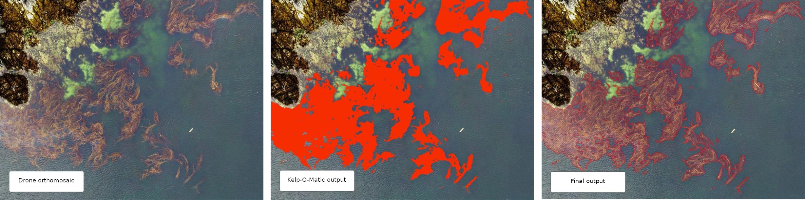
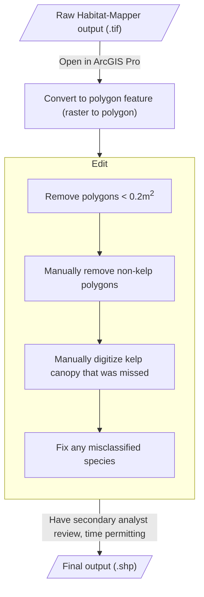
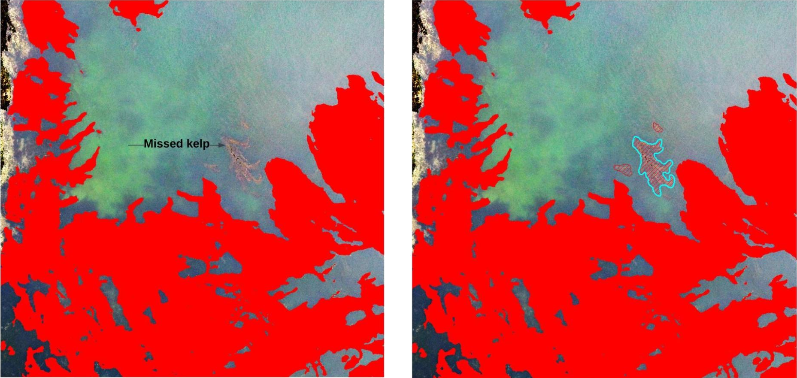

# Post-Process Drone Kelp[^1]

This document describes the methods used for generating analysis ready data on
species-level kelp extent from outputs from the Habitat-Mapper tool. Final outputs
consist of polygon features (.shp) that contain species-level classification of
emergent canopy kelp present in drone imagery.

These instructions use **ArcGIS Pro** (version 3.4+), but can also be adapted for **QGIS**
(a free, open-source alternative). The core workflow is the same across GIS platforms.

!!! info "QGIS Equivalents"
    If using QGIS instead of ArcGIS Pro, the equivalent tools are:

    - **"Raster to Polygon"** → **Raster menu > Conversion > Polygonize (Raster to Vector)**
    - **"Field Calculator"** → **Open Attribute Table > Open Field Calculator** (calculator icon)
    - **"Calculate Geometry"** → **Field Calculator** with expression `$area`
    - **"Select by Attribute"** → **Select Features Using an Expression** (toolbar button)

For questions, please contact [Luba Reshitnyk](mailto:luba.reshitnyk@hakai.org) at
the [Hakai Institute](https://hakai.org).

[^1]: Created by Luba Reshitnyk, February 2023

## Workflow Overview

[//]: # (See: https://mermaid.js.org/syntax/flowchart.html for help)

## Detailed Workflow

This section assumes you have a Habitat-Mapper output (.tif) from `kelp-rgb` or `kelp-rgbi`
open in a new ArcGIS Pro (3.4) project. The same steps work in other GIS software such as QGIS.

??? tip "Tip: ArcGIS Pro Keyboard Shortcuts"

    Keyboard shortcuts can make the editing process much faster. To enable some, go
    to `Customize > Customize Mode > Keyboard…`.

    Some useful shortcuts include:

    1. Edit tool (set to ++ctrl+e++)
        1. This lets you toggle to the editor tool.
    2. Delete (set to ++ctrl+d++)
        1. Delete selected polygon features.
    3. Freehand tool (set to ++ctrl+r++)
        1. Toggle to freehand tool to manually digitize kelp feature polygons.
    4. Clip (set to ++ctrl+w++)
        1. Quickly draw a polygon then click ctrl+W to delete the polygon features
           within the newly drawn polygon. Then delete that polygon.

### Load Habitat-Mapper Raster

Load the output `.tif` file from Habitat-Mapper into ArcGIS Pro. The raster has these values:

| Output value (gridcode) | Class                                |
|------------------------:|--------------------------------------|
|                   **0** | Background                           |
|                   **1** | *Macrocystis pyrifera* (giant kelp)  |
|                   **2** | *Nereocystis luetkeana* (bull kelp)  |

These are the `kelp-rgb` and `kelp-rgbi` classes. See [Kelp: Drone](../models/kelp-drone.md#outputs).

### Convert to Polygons

Convert this raster into polygons using the `Raster to Polygon` tool in ArcGIS Pro.

1. Uncheck `simplify polygons`
2. Leave the other defaults as they are

### Add New Attributes to Polygons
#### Note - if you are exporting to GDB you don't need to calculate area

1. Add a new `area` and `species` field
   1. Right-click the layer in the Contents pane
   2. Select `Attribute Table`
   3. Click the `New Field` button in the Fields tab of the ribbon
      1. Name = `area`, Type = `Double`
      2. Name = `species`, Type = `Text`
      3. Click `Save` on the fields tab of the ribbon
2. Calculate the area for each polygon
    1. Right-click the `area` header in the attribute table,
       select `Calculate Geometry...`
        1. Property = `area`
        2. Units = `square meters`
        3. Coordinate system = choose an appropriate projection that preserves area (
           e.g. NAD83 BC
           Albers Equal Area EPSG = 3005)
        4. Click `OK`

### Editing and Data Cleaning

#### Delete small polygons that are unlikely to be kelp

1. Right click layer in the table of contents, Select `Open attribute table`.
   Click `Select by attribute`
2. Select features < 0.2 m2 by typing: `"area" < 0.2`
3. Right click highlighted features in attribute table and click `Delete Selected`
4. Save edits

#### Manually delete non-kelp polygons

There may be areas where the Habitat-Mapper classifier falsely detected kelp and these polygons need to
be removed manually.

1. Select using the edit tool or `Select by Lasso` tool
2. Delete the selected polygon(s)
3. Save edits.

#### Add kelp not detected by Habitat-Mapper

If there are locations where emergent canopy kelp was missed by the Habitat-Mapper classifier (
example in figure below) manually digitize these features using the Freehand Tool. You will need to
manually classify these new regions to species (change value in the attribute table). A 1:100
scale is recommended.

### Review Species Attributes

There may be some areas where the Habitat-Mapper classifier misclassified the species in a given area. These polygons can be edited manually. If you're just interested in presence/absence don't worry about this step.

1. Select all polygon features classified as giant kelp by opening the attribute table
   and `select by attribute`. Select features representing giant kelp by typing: `"gridcode" = 1`.
   At the bottom of the attribute table click on the `Show selected records` tab.
2. Right-click the `species` field you created earlier. Select `Field Calculator`.
3. In the text box enter `Macrocystis pyrifera` (with quotes included) and click OK.
   This will fill
   out that attribute for all the selected polygons.

Repeat steps 1 - 3 for bull kelp by using `"gridcode" = 2` and `Nereocystis luetkeana`.

1. Review all the polygon species classification and manually change ones that the Habitat-Mapper
   classifier
   misclassified by changing the text in the `species` field for that polygon feature.
2. Save edits.
3. Delete the `gridcode` attribute once you are done.
4. Save edits.

### Export Data

That's it! You can now export your data a shapefile or gdb feature class and give it an appropriate name.
