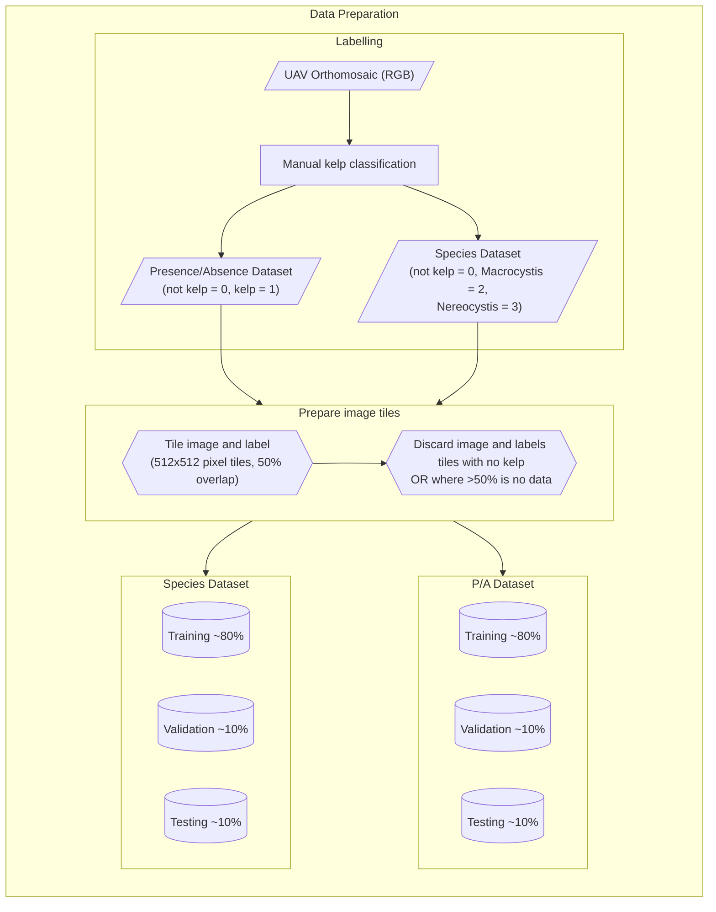
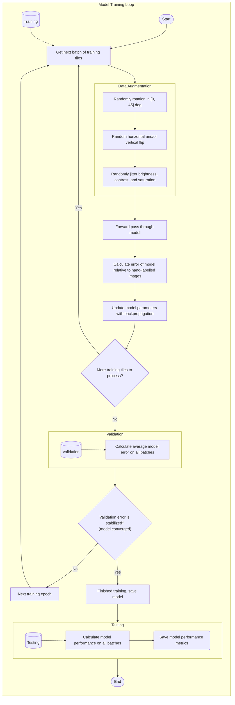

# How the Models Work

Habitat-Mapper models are deep neural networks for *semantic segmentation*: they label every pixel of an image with
a class, such as kelp, mussels or background.

## Processing large images

Orthomosaics are usually far too large to pass through a neural network in one go, so Habitat-Mapper processes them
in pieces:

1. **Read in tiles.** The image is read in square windows of `--crop-size` pixels that overlap by 50%. Each window
   is reordered to the band order the model expects (see `-b`) and normalised.
2. **Predict.** Each window goes through the model, `--batch-size` windows at a time, on a GPU if one is available.
3. **Blend.** Overlapping predictions are blended with a smooth weighting window, so tile edges don't show as seams.
   Larger tiles mean fewer seams (see [Tune Processing](../guides/tune-processing.md#crop-size-quality-vs-memory)).
4. **Label and clean.** The blended scores become one class value per pixel. Then the optional `--blur` and
   `--morph` filters are applied.
5. **Write.** The output GeoTIFF gets the input's location and coordinate system, so it lines up in GIS.

Pixels marked as nodata in the input are skipped. The models are stored in the portable ONNX format and run with
ONNX Runtime, so you don't need a deep learning framework installed.

## How the models were trained

Model training code is available at [:material-github: hakai-ml-train](https://github.com/HakaiInstitute/hakai-ml-train).
Each [model page](index.md) summarises its own training data and results. The diagrams below show the general
process used for the drone kelp models.

### Preparing training data

### Training loop

